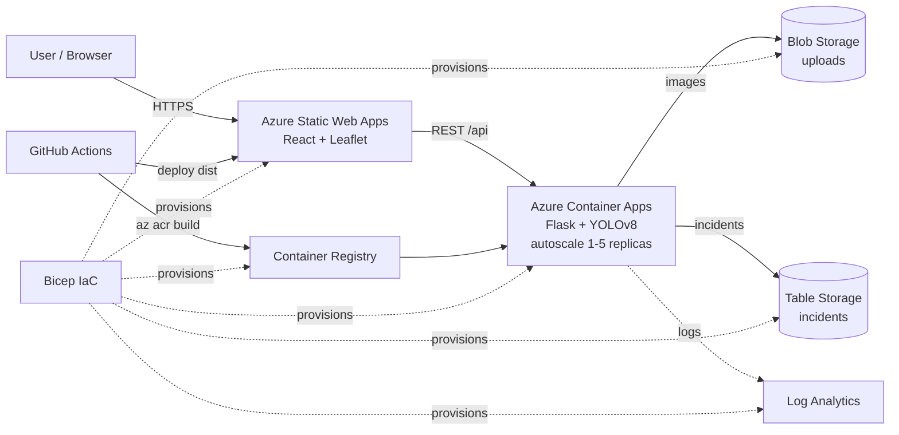

# SmokeGuard AI - Architecture (Azure)

## Design decisions (for the report)
| Decision | Why | Alternative |
|---|---|---|
| Container Apps | HTTP autoscaling with no cluster to manage | AKS (more control, more ops), App Service |
| Table Storage for incidents | Shared across replicas, near-zero cost, same storage account | Azure SQL / Cosmos DB (richer queries, higher cost) |
| Blob Storage for images | Cheap, durable, private access | Azure Files |
| Bicep | Whole environment reproducible from code | Terraform |
| YOLOv8 (object detection) | Gives bounding boxes + fire/smoke classes in one pass | CNN classifier (no localization) |

## Known limitations (be upfront in the presentation)
- Single-image analysis only; no live camera/RTSP stream yet.
- Registry uses the ACR admin credential; production should use managed identity.
- CORS is `*` until you set `frontendOrigin` to the Static Web App URL.
- No authentication yet (Entra ID / Static Web Apps auth is the natural next step).
- Alerts are shown in the dashboard only; email/SMS (Logic Apps / Communication Services) is a next step.
